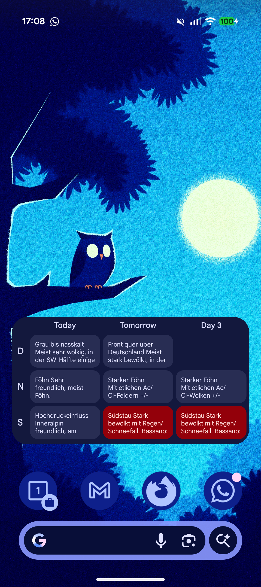
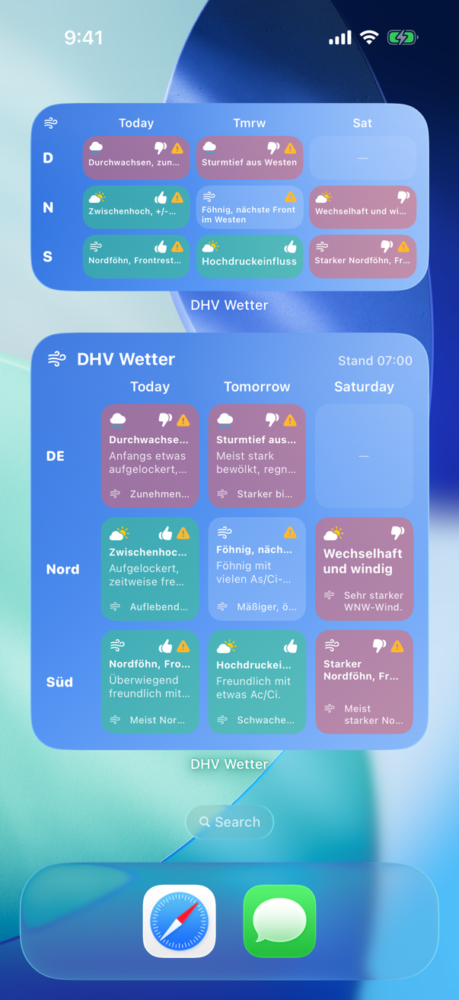
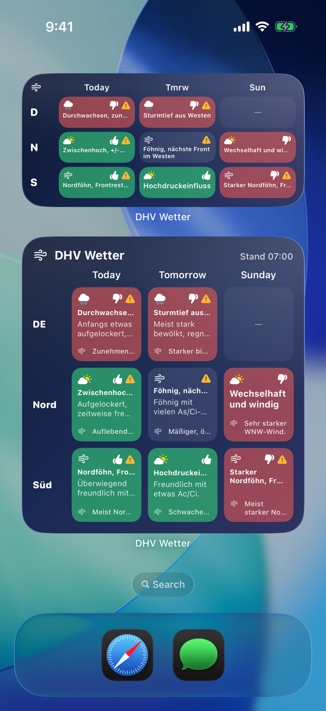
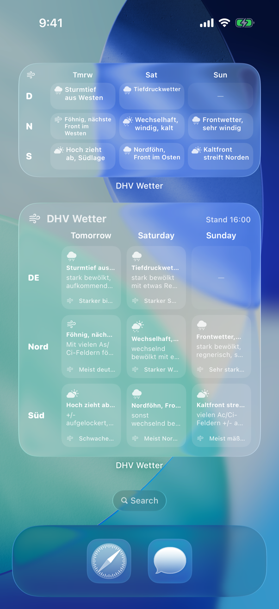
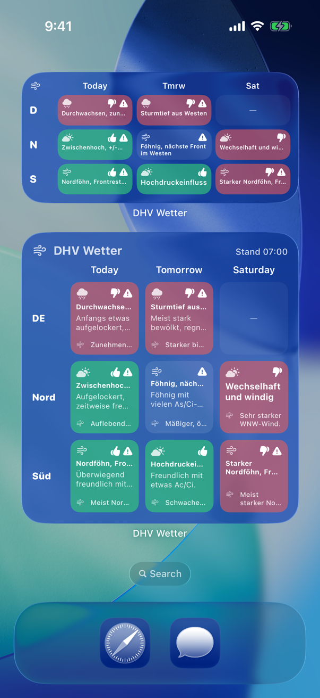
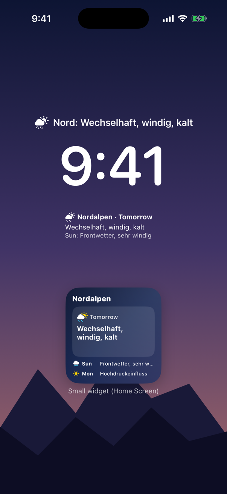

# DHV Weather Widget 🪂

Home Screen widgets and companion apps for **Android and iOS** that show the [DHV-Wetter](https://www.dhv.de/wetter/dhv-wetter/) paragliding forecast for Deutschland, Nordalpen and Südalpen at a glance.

| | Android | iOS |
| --- | --- | --- |
| Code | [`app/`](app/) (Kotlin) | [`ios/`](ios/) (Swift, SwiftUI, WidgetKit) |
| Design | Material 3 with dynamic colours | Liquid Glass (iOS 26) |
| Widgets | 4×2 overview of all regions | Medium and large overview of all regions, small single region, Lock Screen (rectangular and inline) |
| App | Scrollable forecast with expandable cards | Glass forecast cards per region, pull to refresh |
| Install | APK from [Releases](../../releases) | Unsigned IPA from GitHub Actions, signed with your own certificate |

## Android

- Material You colours that follow your wallpaper, light and dark.
- Header with Today, Tomorrow and the day name, one row per region.
- Refreshes when you open the app and every 3 hours in the background.

Install:

1. Download the latest `app-debug.apk` from the [Releases](../../releases) page.
2. Install it (allow installs from unknown sources if asked).
3. Long-press the Home Screen → **Widgets** → **DHV Weather**.

## iOS

    

Real iOS 26 Home Screen in the simulator: Default, Dark, Clear and Tinted, with the built-in sample forecast so DHV's markers show. The glass is drawn by iOS itself.

- Built to Apple's widget guidance for Liquid Glass: the background lives in `containerBackground`, so with a **Clear** or **Tinted** Home Screen (long-press → Edit → Customize) iOS swaps it for real Liquid Glass or your tint. In Default and Dark the widget is full colour.
- Day tiles are tinted by DHV's own markers (Thermikwetter, Störungswetter, Warnhinweis), with weather icons read from DHV's bold key phrases. The green, yellow and red stay in colour on a Clear or Tinted Home Screen too, and each marked day also shows its symbol.
- Days are matched and labelled by date, so the columns stay right after DHV's evening update and at midnight.
- Refreshes shortly after DHV's announced next update, at least every 3 hours, and whenever you open the app.

Install:

1. Open **Actions** → **iOS** → the latest green run on `main`, and download **DHVWeather-unsigned-ipa**. Pushing a tag like `ios-v1.0.0` also attaches it to a release.
2. Sign it with your certificate and provisioning profile in your usual tool (ESign, Feather, Sideloadly, zsign…), keeping the widget extension inside the app.
3. Install, open the app once, then long-press the Home Screen → **Edit** → **Add Widget** → **DHV Wetter**.

Signing notes, App Groups and building in Xcode are in [ios/README.md](ios/README.md).

## Build

- Android: `./gradlew assembleDebug`
- iOS: `brew install xcodegen && cd ios && xcodegen generate`, then open `DHVWeather.xcodeproj` in Xcode 26. CI builds the unsigned IPA on every push to `ios/`, and screenshots the widgets on the simulator's real Home Screen (a SpringBoard UI test) in each appearance.

The forecast comes from the DHV website and belongs to the Deutscher Hängegleiterverband. It is not an official flight weather briefing: the pilot decides.
